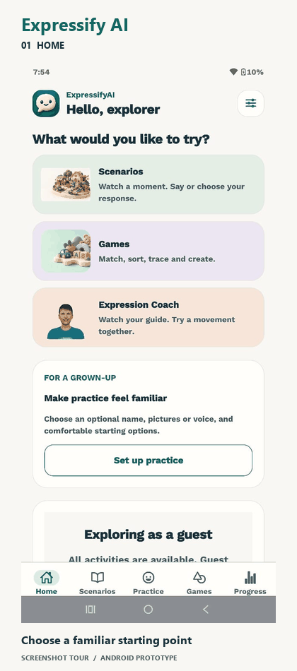
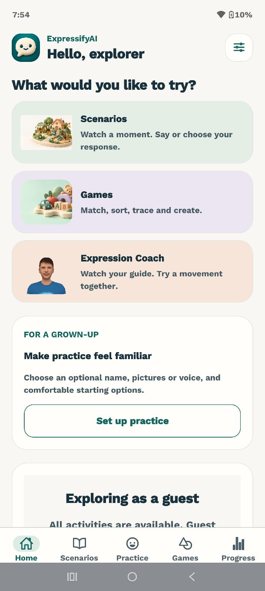
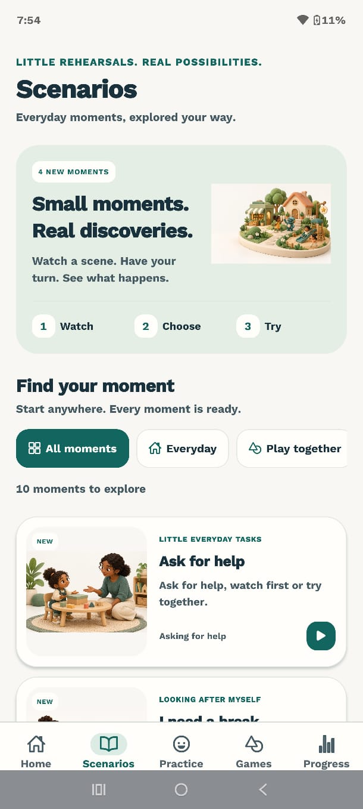
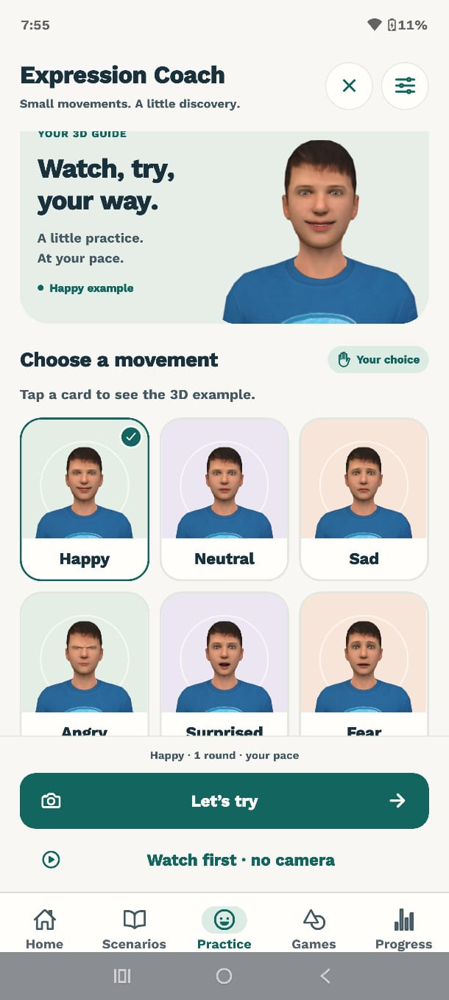
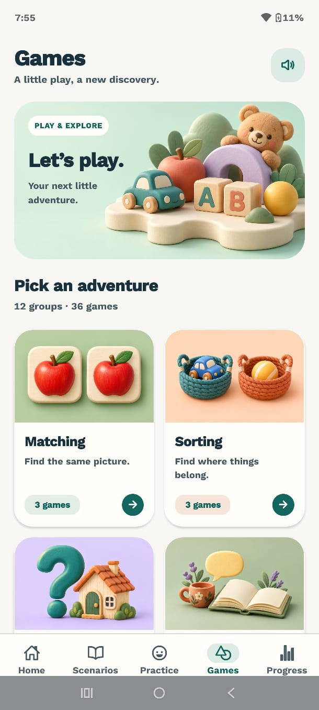
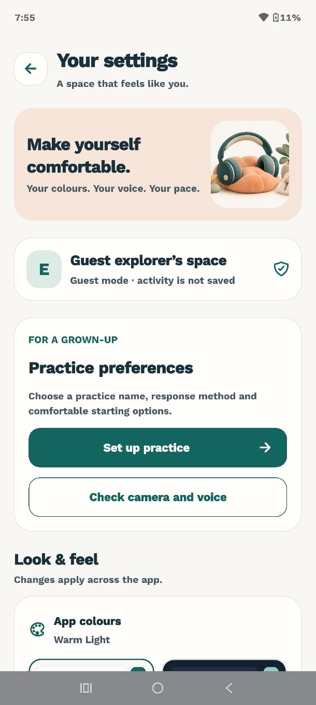
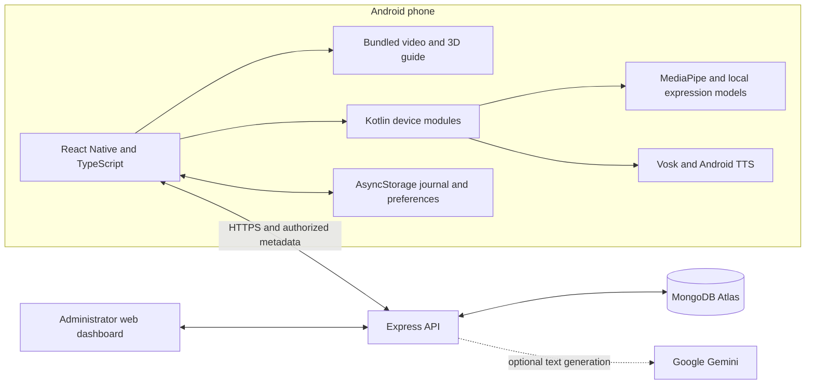

<div align="center">

# Expressify AI

### Everyday communication practice, at your own pace

An Android learning app with interactive scenarios, a 3D expression coach, offline speech recognition, and 36 play activities.

Built for caregiver-supported exploration by autistic children, with picture choices, optional camera activities, and room to pause or skip.


[Product tour](#product-tour) · [Screenshots](#screenshots) · [Features](#features) · [Architecture](#architecture) · [Setup](docs/SETUP.md)

</div>

## Overview

Expressify AI brings everyday roleplay, visible facial-movement examples, and introductory games into one mobile experience. A child can watch an animated moment, respond with a picture or confirmed spoken answer, explore an expression with a 3D guide, or choose a game.

The engineering combines a **React Native and TypeScript app**, **Kotlin device modules**, **local vision and speech models**, and an **Express and MongoDB backend** for accounts, authorized caregiver access, synchronized participation, and stored-data reports.

This repository is the **public project showcase**. It contains product screenshots, a preview GIF, architecture documentation, and development setup guidance. The application source, credentials, learner records, native models, and character assets are maintained separately. Cloning this showcase alone does not build the app.

## Product tour

<p align="center">
  
</p>

**15-second screenshot tour.** Assembled from real Android screenshots supplied for this showcase; it is a visual overview rather than a recording of live interaction. No camera feeds, microphone audio, or learner records appear in it.

## Screenshots

<table>
  <tr>
    <td align="center"><strong>Home</strong><br></td>
    <td align="center"><strong>Scenarios</strong><br></td>
    <td align="center"><strong>Expression Coach</strong><br></td>
  </tr>
  <tr>
    <td align="center"><strong>Games</strong><br></td>
    <td align="center"><strong>Settings</strong><br></td>
    <td align="left"><strong>One connected experience</strong><br><br>Home · Scenarios · Practice · Games · Progress<br><br>Warm themes, picture choices, caregiver preferences, pause and recovery controls.</td>
  </tr>
</table>

## Features

### Interactive everyday scenarios

- **10 moments** covering classroom participation, shopping, playground turns, joining play, toy requests, communicating discomfort, asking for help, requesting a break, toilet support, and changed plans.
- Local animated video scenes with device-generated narration and picture responses.
- Offline spoken responses with an explicit confirmation step and picture correction.
- Classroom hand-raise interaction using MediaPipe hand and face landmarks.
- Optional camera mirror in everyday activities; physical actions and feelings are not inferred from it.

### Expression Coach

- Ayaan, a locally rendered **Three.js 3D guide** inside React Native WebView.
- Six movement examples: happy, neutral, sad, angry, surprised, and fearful.
- **Watch → Together → Your turn** stages, camera-free watch mode, and movement mirroring.
- Local expression analysis using MediaPipe and a MobileNet TFLite model; an EfficientNet ONNX alternative is available for technical comparison.
- Sustained-match checks, uncertainty handling, replay, skip, break, and explicit resume.
- Word-timed mouth-animation cues from Android TTS; this is approximate animation, not phoneme-accurate lip synchronization.

### Games and comfortable interaction

- **36 games across 12 groups:** Matching, Sorting, Questions, Everyday Words, Letters, Patterns, Memory, Numbers, Puzzles, Colouring, Tracing, and Flashcards.
- Untimed interaction, retry/help controls, and skip without claiming an unearned correct answer.
- Real finger tracing through ordered checkpoints, child-controlled memory reveals, and paint application.
- Warm light/dark presentation, system text scaling, reduced-motion support, and practice preferences.
- Optional grown-up setup and separate camera/voice equipment checks.

### Accounts, progress, and caregiver support

- Separate learner and caregiver mobile workspaces; administrator web dashboard.
- Approved caregiver–learner links and role/ownership checks on protected operations.
- Account-scoped local participation journal with retry-safe upload/download synchronization.
- Progress charts and exploration achievements; historical scored curriculum remains separate.
- Measurable caregiver goals and authorized date-range learning reports with Android PDF export.
- Server-issued attempts and transactional reward receipts for the earlier scored curriculum.

## Technology stack

| Layer | Technologies | Responsibility |
| --- | --- | --- |
| Mobile interface | React Native 0.87.1, React 19.2.3, TypeScript | Screens, activity state, content and reusable UI |
| Navigation and storage | React Navigation 7, AsyncStorage | Tab/stack navigation, account-scoped preferences and journal |
| Camera and graphics | Vision Camera 5, React Native Skia 2 | Preview, snapshots and graphics support |
| Android modules | Kotlin 2.2, Android TTS, AudioRecord | Native sensing, narration, lifecycle and report export |
| Local vision | MediaPipe 0.10.21, TensorFlow Lite 2.17, ONNX Runtime 1.26 | Face/hand landmarks and expression-model inference |
| Offline speech | Vosk Android 0.3.75, bundled small English model | On-device response decoding |
| 3D and video | Three.js 0.186.1, WebView 14, React Native Video 6 | Interactive guide and bundled scenario media |
| Backend | Node.js 22, Express 5, Mongoose 9, MongoDB Atlas | Accounts, authorization, saved activity and reports |
| Authentication | JWT, bcryptjs, HttpOnly portal sessions, CSRF controls | Mobile and administrator access |
| Optional text AI | Google Gemini backend integration | Supplementary generated text with authored fallbacks |
| Verification and delivery | Jest, Node test runner, TypeScript, ESLint, Gradle, Vercel | Regression checks, Android builds and hosted backend |

Versions describe project configuration; they are not a claim that these are the latest available releases. See [setup](docs/SETUP.md) for native toolchain settings.

## Architecture




**Local sensing:** camera frames and microphone PCM are processed on the phone. Normal synchronization uploads limited participation metadata and explicitly saved summaries, not camera images or voice transcripts.

**Server authority:** the backend checks account status, roles, approved links, attempt ownership, and grading/reward rules. Durable operation identities prevent duplicate effects on retry.

**Different evidence stays separate:** participation visits, authored knowledge-check scores, and device-reported camera matches have different meanings. None is a clinical measure.

Read [architecture and data flow](docs/ARCHITECTURE.md) for the module breakdown, contracts, and engineering decisions.

## Setup

Full instructions are in **[docs/SETUP.md](docs/SETUP.md)**. They apply to an authorized application-source checkout, which is separate from this showcase.

```powershell
# In the application-source directory
npm ci
Push-Location backend
npm ci
Copy-Item .env.example .env
# Configure MONGODB_URI and JWT_SECRET locally, then return to the app root.
Pop-Location

# Connect and authorize one Android phone, then build and launch.
powershell -ExecutionPolicy Bypass -File .\start-android.ps1 -Install
```

The backend needs a transaction-capable MongoDB deployment. Gemini is optional. Never place backend secrets in the app bundle or this public repository.

## Engineering highlights

- **Explicit activity state:** media, narration, microphone input and answer confirmation coordinate before advancing a turn.
- **Lifecycle ownership:** pause, backgrounding and exit cancel relevant sensing, speech and pending work; returning requires a deliberate resume.
- **Retry-safe persistence:** immutable participation event IDs and transactional scored receipts prevent duplicate saves and rewards.
- **Server-side authorization:** a learner ID alone grants no caregiver access; active approved links are checked on protected reads and writes.
- **Graceful alternatives:** pictures, still images, watch-first mode, skip and retry keep a failed sensor or renderer from trapping an activity.
- **Honest metrics:** model confidence is separate from measured accuracy, and software tests are separate from learning-outcome evaluation.

## Verification and project status

The application workspace contains mobile Jest tests, TypeScript and lint checks, backend Node tests, opt-in isolated database integration tests, native speech fixtures, and renderer/device checks. They cover session transitions, account isolation, authorization, cancellation, idempotency and report contracts.

The project is an **Android-first working prototype**. Intended-user evaluation, child/accent speech and face-model benchmarking, sustained device measurements, and public-release operational checks remain important next steps. iOS native sensing parity and Urdu/RTL support are future work.

No recognition accuracy, therapeutic benefit, or real-world learning gain is claimed by this showcase. A face does not determine a person's internal feelings.

## Repository contents

```text
README.md                  Product overview and visual walkthrough
docs/
  ARCHITECTURE.md           Modules, data flow and engineering decisions
  SETUP.md                 Application prerequisites and run instructions
  CREDITS.md               Screenshot provenance and third-party context
  architecture.svg         GitHub-friendly architecture diagram
  screenshots/             Five supplied Android screenshots
  media/                   Fifteen-second screenshot tour
tools/
  build_tour.py            Rebuild the screenshot GIF locally
```

## Author and project links

Created by **[Syed Labib](https://github.com/syedlabib4)** as the Expressify AI project.

- [Architecture notes](docs/ARCHITECTURE.md)
- [Application setup](docs/SETUP.md)
- [Media and technology credits](docs/CREDITS.md)
- [Questions about the project](https://github.com/syedlabib4/expressify-ai/issues)

The screenshots show the current guest-facing Android experience. Application source access and release artifacts are managed separately.
