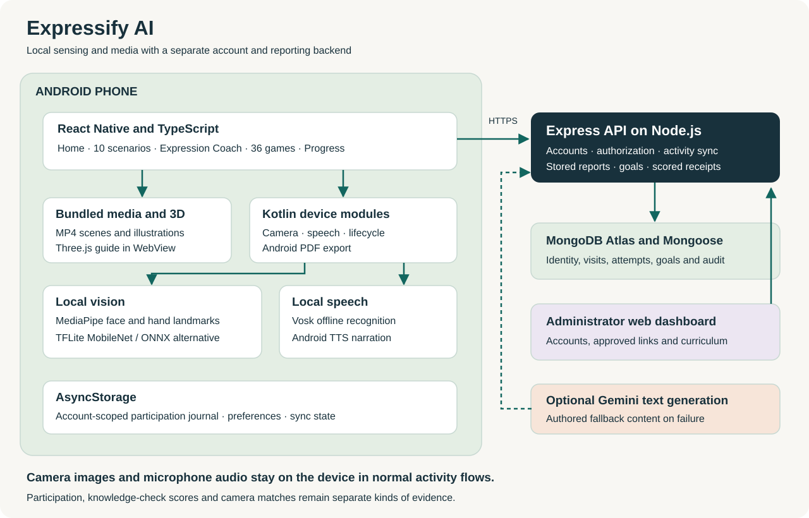

# Architecture and engineering decisions

Expressify AI has three main boundaries: the mobile experience, local device processing, and the account backend. Camera and speech inference run locally; the backend owns authorization, saved records and scored reward rules.

## Mobile application

React Native and TypeScript provide five tabs: Home, Scenarios, Practice, Games and Progress. Stack routes provide settings, caregiver tools, equipment checks, reports and historical record views.

The application is organized around screens, reusable components, activity hooks, authored content, device/HTTP services and session reducers. The separation makes answer commitment, pause/resume, retries and early completion explicit rather than tying outcomes to a screen animation.

| Module | Responsibility |
| --- | --- |
| Scenario content and session hooks | Ten activity entries, authored conversation branches, narration/response sequencing and recovery |
| Classroom | Authored questions, hand-raise observations, confirmed spoken answers and picture alternatives |
| Expression Coach | Watch/Together/Your turn stages, Ayaan renderer, demonstrations, mirroring and sustained-match behavior |
| Games | Twelve groups and thirty-six game definitions with activity-specific reducers |
| Journal and synchronization | Local visit records, serialized account writes, immutable upload IDs and paginated downloads |
| Account context and API client | Token restoration, unauthorized handling, endpoint configuration and request contracts |

## Native Android boundary

Kotlin modules expose local capabilities to the React Native app:

- **MediaPipe Face Landmarker** supplies facial landmarks and blendshape observations.
- **MediaPipe Hand Landmarker** supplies tracked hand points for the classroom interaction.
- **TensorFlow Lite** executes the default MobileNet image classifier.
- **ONNX Runtime** executes an alternative EfficientNet classifier for technical comparison.
- **Vosk** decodes 16 kHz mono microphone PCM in memory, with a bundled English model.
- **Android TTS** provides narration and range events for approximate mouth cues.
- **Android PdfDocument** renders a report and opens the system document picker for an explicit save destination.

The expression path crops a detected face, resizes it to 224 × 224, applies model-specific preprocessing and evaluates local outputs. Temporal and freshness checks govern matching. Model confidence is not measured accuracy. Uncertain/no-face states remain explicit, and unsupported labels do not become valid practice targets.

The classroom requires a fresh, sustained hand-raise observation. The other everyday scenarios may show a camera mirror but do not use it to validate shopping, play, discomfort, or other real-world actions.

## Media and 3D

Scenario videos and illustrations are bundled. Device speech supplies changing dialogue. Responses wait for both relevant playback and narration to finish. Pictures remain available, and decode failure/reduced motion uses still alternatives.

Three.js renders Ayaan locally in a restricted WebView. The current character uses Rocketbox Male_Child_01 with expression controls and speech visemes. Demonstrations, movement mirroring and talking animation have separate responsibilities. Pause and reduced motion stop continuous work; renderer failure exposes a still fallback and retry.

## Backend

Node.js and Express provide JSON APIs and serve the responsive administrator dashboard. Mongoose models persist identity, approved caregiver relationships, learning attempts, participation visits, goals, reports and administrative revisions in MongoDB Atlas.

| API family | Responsibility |
| --- | --- |
| `/api/auth` | Registration, login and mobile session restoration |
| `/api/activities` | Own-account participation upload and pagination |
| `/api/user` | Profile, summaries, rewards and saved camera sessions |
| `/api/scenarios` | Historical connected-curriculum attempts, tasks, completion and history |
| `/api/progress` | Server-issued legacy lesson questions and committed answers |
| `/api/goals` | Authorized caregiver assignment and measurable progress |
| `/api/reports` | Own/linked learner date-range report generation |
| `/api/portal` | Administrator sessions, linking, status and audit access |
| `/api/administration` | Account management and versioned curriculum operations |
| `/api/gemini` | Optional text generation and compatibility routes |
| `/api/health` | Database-aware health check |

Gemini is an optional text service with authored fallbacks. It is not the face-analysis or offline speech engine, and the core current activities do not need a Gemini key.

## Data flow and consistency

### Current participation

1. A signed-in learner reaches an activity's qualifying finish state.
2. The app writes a minimal account-scoped visit locally.
3. Pending visits upload in batches; downloaded pages merge into the journal.
4. The server upserts immutable account/event identities, so reconnects do not duplicate records or award XP.
5. Progress and authorized reports can include synchronized visits.

Visit records contain an ID, kind, title, timestamp and optional group. Detailed spoken answers, camera media and game-round outcomes are outside this stream. Device timestamps describe participation and are not independently verified achievements.

### Historical scored curriculum

1. The backend checks access and issues a versioned attempt.
2. Required acknowledgments, paths and answers are committed through protected endpoints.
3. Answers cannot be changed after commitment; identical retries are accepted.
4. A transaction stores completion, reward changes and a durable receipt together.
5. Repeated final submissions return the original result.

The earlier twelve-scenario curriculum and level lessons remain separate from today's ten-video gallery. Current participation counts must not be interpreted as historical quiz scores.

## Security and privacy

JWT verification is followed by stored account role, status and session-version checks. Caregiver operations require an approved active relationship. Administrator portal sessions use HttpOnly cookies, revocable server sessions and CSRF checks.

Normal synchronization and report payloads exclude camera images, microphone recordings and transcripts. Backend credentials remain server-only. Guest activity is unsaved. Local practice preferences are account-scoped.

The mobile token currently uses AsyncStorage; hardware-backed token storage is a release improvement. Other operational priorities include distributed throttling, monitored deployments, backups, retention/deletion procedures and reviewed child-account/consent processes. Per-instance rate limits should not be described as a distributed control.

## Verification boundaries

The project separates four questions:

1. **Software reliability:** do lifecycle, authorization, persistence and retry rules work?
2. **Recognition performance:** how well do models behave on independently labeled relevant data?
3. **Usability:** can intended users and caregivers understand and control the experience?
4. **Learning outcomes:** does supported practice lead to independently observed changes beyond the app?

Unit tests, numerical model fixtures and sample device checks support the first question. They do not establish the other three. Public-release acceptance and supervised evaluation remain separate work.
